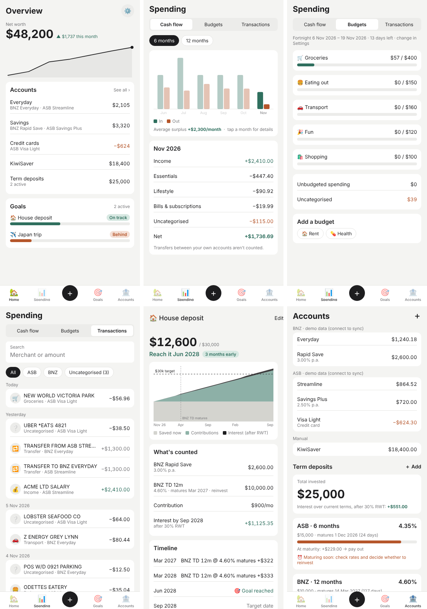

# budgeting-mobile

A personal budgeting app for tracking spending across **BNZ** and **ASB** accounts, forecasting savings towards goals, and factoring **term deposits (with interest, after RWT)** into those forecasts.

Built with Expo (React Native + TypeScript), so it runs on iOS, Android and the web.

## Run it

```bash
npm install
npx expo start        # then scan the QR code with the Expo Go app on your phone
npm run web           # or open it in a browser
```

```bash
npm test              # forecast + analytics unit tests
npm run typecheck
```



## What's in it

| Screen | Wireframe | What it does |
|---|---|---|
| Home | 1C | Net worth with a 6-month trend, accounts grouped by type, goal progress |
| Spending › Cash flow | 2A | Money in vs. out per month (6 or 12 months); tap a month for its breakdown |
| Spending › Budgets | 3B | Per-category budgets for the current week, fortnight or month, aligned to payday |
| Spending › Transactions | 4 | Search, filter by bank or uncategorised; tap to categorise and create a rule |
| Goals / goal detail | 5A | Forecast chart split into saved, contributions and interest; on-track date; required monthly saving |
| Accounts | 6, 7 | Accounts by bank; term deposits with maturity countdown and after-tax interest |
| ＋ (centre tab) | 8B | Quick add: transaction, term deposit or goal |

The app currently runs on **demo data held in memory**. Saving data on the phone and bank sync come next (see the roadmap in `docs/DESIGN.md`).

## Layout

```
src/
  app/          screens (Expo Router: every file is a route)
  components/   UI kit and SVG charts
  data/         state store, demo data, selectors
  lib/          pure logic: forecast engine, term deposit maths, analytics (unit tested)
docs/
  DESIGN.md       features, forecasting maths, data model, roadmap
  wireframes.html the original wireframe options
```
